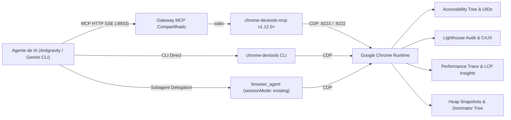

# SKILL: Chrome DevTools para Agentes (Padrão Oficial Google)

> **Fonte Canônica:** [developer.chrome.com/docs/devtools/agents](https://developer.chrome.com/docs/devtools/agents?hl=pt-br) | [github.com/ChromeDevTools/chrome-devtools-mcp](https://github.com/ChromeDevTools/chrome-devtools-mcp)  
> **Arquitetura:** Chrome DevTools MCP (`chrome-devtools-mcp@1.12.0+` via Gateway HTTP SSE `:8933`) + CLI (`chrome-devtools`) + Subagente Nativo (`browser_agent`) + Chrome DevTools Protocol (CDP `:9222` / `:9223`)

---

## 1. Visão Geral, Topologia de Portas e Modos de Execução

O **Chrome DevTools for Agents** (`chrome-devtools-mcp`) concede aos agentes de IA (Antigravity, Gemini CLI, Claude Code, Codex, Cursor) controle completo sobre instâncias reais do Google Chrome via **Servidor MCP** e **CLI standalone** (`chrome-devtools`), alimentado pelo Puppeteer e pelo Chrome DevTools Protocol (CDP).



### 1.1 Topologia Canônica de Portas e Configuração no Núcleo (`nucleo_compartilhado.json`)
*   **Porta `8933` (Gateway MCP Compartilhado):** Expõe `http://127.0.0.1:8933/servers/chrome-devtools/mcp` para todos os hospedeiros sem multiplicar processos Node.js residentes.
*   **Porta `9223` (Instância Admin / Automação):** Instância Chrome dedicada conectada via `--browserUrl=http://127.0.0.1:9223`.
*   **Porta `9222` (Instância Dev / Usuário):** Navegador interativo principal; compatível com `--autoConnect` (Chrome 144+ com `chrome://inspect/#remote-debugging` ativo) ou `--browserUrl=http://127.0.0.1:9222`.
*   **Flags SOTA Ativas no Núcleo:**
    *   `--categoryPerformance=true`, `--categoryNetwork=true`, `--categoryEmulation=true`, `--categoryMemory=true`, `--memoryDebugging=true`
    *   `--screenshotFormat=webp`, `--screenshotQuality=80`, `--screenshotMaxWidth=1280` (reduz em 3–5x o peso de imagem e economiza tokens de visão)
    *   `--redactNetworkHeaders=true` (protege headers sensíveis antes de retornar ao cliente MCP)
    *   `--no-usage-statistics`, `--no-performance-crux` e variáveis de ambiente `CHROME_DEVTOOLS_MCP_NO_USAGE_STATISTICS=1` e `CHROME_DEVTOOLS_MCP_NO_UPDATE_CHECKS=1` (zero telemetria externa e zero vazamento de URLs locais para a API CrUX).
    *   `--slim`: Reservado apenas para cenários ultraleves (expõe somente 3 ferramentas: navegação, avaliação JS e screenshot).

---

## 2. Protocolo de Grounding Visual e Árvore de Acessibilidade (`pageId` & `uid`)

Para máxima robustez e **imunidade a alterações cosméticas de CSS ou classes Tailwind**, os agentes operam sobre a árvore semântica de acessibilidade:

1.  **Endereçamento por `pageId` (`--pageIdRouting`):**
    *   Todas as ferramentas de página exigem `pageId` explícito (ex.: `pageId: 1`).
    *   Invocar `list_pages` para listar abas abertas ou capturar o `pageId` retornado por `new_page`.
2.  **Captura de Snapshot Estruturado (`take_snapshot`):**
    *   Retorna a árvore de acessibilidade com identificadores `uid` unívocos e atributos semânticos (`role`, `name`, `value`, `level`, estado `focused`).
    *   Em ações subsequentes (`click`, `fill`, `hover`, `drag`), manter `includeSnapshot: false` a menos que a mutação de DOM exija releitura imediata.
3.  **Inspeção de CSS Autoritativa (`get_css_styles`):**
    *   Utilizar `get_css_styles` passando `pageId` e `uid` (com paginação `pageSize` / `pageIdx`) para inspecionar regras aplicadas, cascata e variáveis CSS (`--color-*`).
4.  **Element-Level Screenshot (`take_screenshot`):**
    *   Capturar componentes isolados informando o `uid` do contêiner ou salvar em disco via `filePath` para evitar inflar a janela de contexto.

---

## 3. Workflows Especializados (7 Skills Oficiais Integradas)

O runtime local (`tools/mcp-runtime/node_modules/chrome-devtools-mcp/skills`) disponibiliza 7 fluxos especializados que também são descobertos automaticamente pelo Antigravity SDK (`llm/antigravity_sdk_bridge.py`):

### 3.1 Depuração e Otimização de LCP (`debug-optimize-lcp`)
Decompõe o **Largest Contentful Paint ($\le 2.5\text{s}$)** em 4 subpartes sequenciais sem lacunas:

| Subparte | Meta (% do LCP) | Diagnóstico e Mitigação SOTA |
| :--- | :--- | :--- |
| **1. TTFB (Time to First Byte)** | $\sim 40\%$ ($\le 800\text{ms}$) | `DocumentLatency`: otimizar resposta do servidor, cache de borda e eliminar redirects. |
| **2. Resource Load Delay** | $< 10\%$ | `LCPDiscovery`: remover `loading="lazy"` de imagens no viewport inicial; adicionar `fetchpriority="high"` e `<link rel="preload">`. |
| **3. Resource Load Duration** | $\sim 40\%$ | Converter para WebP/AVIF, usar `srcset` responsivo e `font-display: swap`. |
| **4. Element Render Delay** | $< 10\%$ | `RenderBlocking`: eliminar scripts síncronos no `<head>`, fazer inline de CSS crítico e garantir SSR no HTML inicial. |

**Fluxo de Execução:**
1. `navigate_page` (`pageId`) $\longrightarrow$ `performance_start_trace` (`reload: true`, `autoStop: true`).
2. `performance_analyze_insight` com `insightSetId` e `insightName` (`"LCPBreakdown"`, `"DocumentLatency"`, `"RenderBlocking"`, `"LCPDiscovery"`).
3. Identificar o elemento LCP via `evaluate_script` (`PerformanceObserver` sobre `largest-contentful-paint` com `buffered: true`).
4. Verificar cascata de rede com `list_network_requests` (`resourceTypes: ["image", "font"]`) e `get_network_request`.
5. Validar sob restrição realista com `emulate` (`networkConditions: "Fast 3G"`, `cpuThrottlingRate: 4`).

### 3.2 Diagnóstico de Vazamento de Memória (`memory-leak-debugging`)
Com `--memoryDebugging=true` ativo no núcleo, **nunca leia arquivos `.heapsnapshot` brutos no contexto**. Execute o pipeline determinístico:
1. **Amplificação e Captura (`take_heapsnapshot`):** Capturar snapshot base (`base.heapsnapshot`), repetir a interação suspeita $10\times$, reverter ao estado original e capturar `target.heapsnapshot`.
2. **Resumo e Diff (`get_heapsnapshot_summary` & `compare_heapsnapshots`):** Comparar `base` vs. `target` sem `classIndex` para obter o resumo de crescimento; em seguida filtrar pelo `classIndex` suspeito.
3. **Filtros Categorizados (`get_heapsnapshot_details` / `get_heapsnapshot_class_nodes`):** Aplicar `filterName`:
   * `objectsRetainedByDetachedDomNodes` (nós DOM destacados retidos em JS — confirmar com o usuário antes de anular caches intencionais).
   * `objectsRetainedByEventHandlers` (listeners não removidos no unmount).
   * `objectsRetainedByContexts` (closures retendo escopo externo).
   * `objectsRetainedByConsole` (objetos presos por `console.log`).
4. **Cadeia de Retenção:** Inspecionar `get_heapsnapshot_retaining_paths`, `get_heapsnapshot_retainers`, `get_heapsnapshot_dominators`, `get_heapsnapshot_object_details` e `get_heapsnapshot_duplicate_strings`.
5. **Higienização Obrigatória (`close_heapsnapshot`):** Fechar todos os snapshots carregados ao término da análise para liberar RAM do servidor MCP.

### 3.3 Auditoria de Acessibilidade WCAG (`a11y-debugging`)
1. **Baseline Automatizado (`lighthouse_audit`):** Executar em `mode: "navigation"` e filtrar falhas do `report.json` via Node one-liner (`Object.values(r.audits).filter(a => a.score !== null && a.score < 1)`).
2. **Issues Nativos do Browser:** `list_console_messages` com `types: ["issue"]` e `includePreservedMessages: true`.
3. **Semântica, Foco e Tap Targets:**
   * Validar hierarquia de headings (`h1` $\to$ `h2` $\to$ `h3`) e landmarks via `take_snapshot`.
   * Testar navegação por teclado e armadilhas de foco em modais com `press_key` (`"Tab"`, `"Shift+Tab"`) seguido de `take_snapshot`.
   * Auditar inputs órfãos, dimensões mínimas de toque ($48 \times 48\text{px}$) e contraste WCAG AA ($4.5:1$ texto normal, $3:1$ texto grande) via `evaluate_script`.

### 3.4 Depuração de Cookies, Sessão e Consentimento (`cookie-debugging`)
*   **Cookies `HttpOnly` vs. Client-Side:** Cookies `HttpOnly` são invisíveis para `document.cookie` / `cookieStore`. Inspecione-os nos headers `Cookie` (request) e `Set-Cookie` (response) via `get_network_request` (`includePreservedRequests: true`).
*   **Cookies Acessíveis no Cliente:** Utilizar `evaluate_script` com `async () => await cookieStore.getAll()`.
*   **Isolamento Clean-Slate (`isolatedContext`):** Para testar banners de consentimento LGPD/GDPR, primeiro acesso ou estados deslogados sem contaminar a sessão ativa, invocar `new_page` com `isolatedContext: "consent-audit-1"` e encerrar com `close_page`.
*   **Auditoria SameSite / CHIPS:** Inspecionar `CookieIssue` (`SameSiteNoneInsecure`, `ThirdPartyCookiePhaseout`, `PartitionedCookies`) via `list_console_messages(types: ["issue"])`.

### 3.5 Automação via CLI (`chrome-devtools-cli`)
Para scripts shell ou automações rápidas no terminal sem round-trip MCP:
```powershell
# Listar abas, capturar snapshot e interagir mantendo estado em background
node "C:\Users\rapha\.gemini\tools\mcp-runtime\node_modules\chrome-devtools-mcp\build\src\bin\chrome-devtools.js" list_pages
node "C:\Users\rapha\.gemini\tools\mcp-runtime\node_modules\chrome-devtools-mcp\build\src\bin\chrome-devtools.js" take_snapshot 1
node "C:\Users\rapha\.gemini\tools\mcp-runtime\node_modules\chrome-devtools-mcp\build\src\bin\chrome-devtools.js" lighthouse_audit 1 --mode navigation --output-format=json
```

---

## 4. Integração com Subagentes (`browser_agent`, `codebase_investigator` e Agentes Customizados)

No `C:\Users\rapha\.gemini\settings.json`, os subagentes integrados e customizados operam de forma coordenada:

*   **`browser_agent` (`agents.browser`):** Configurado com `sessionMode: "existing"`, `headless: false` e `maxActionsPerTask: 120`, anexando-se à sessão existente sem abrir perfis concorrentes.
*   **`codebase_investigator` (`agents.overrides.codebase_investigator`):** Habilitado com `maxTurns: 25` e `maxTimeMinutes: 5` para mapeamento arquitetural e análise de dependências sem poluir a janela de contexto principal.
*   **Subagentes Customizados (`~/.gemini/agents/*.md`):** Definições declarativas em Markdown com frontmatter YAML (`name`, `description`, `kind: local`, `tools`, `max_turns`, `timeout_mins`) especializadas em auditoria CWV/DevTools, matemática PMev e segurança.

---

## 5. Ciclo de Validação Zero-Rework e Resolução de Problemas (`troubleshooting`)

$$\text{Código / Diff} \longrightarrow \text{Build Turbopack} \longrightarrow \text{CDP Navigation} \longrightarrow \text{Trace + A11y + Heap Pass} \longrightarrow \text{Zero-Rework Pass}$$

*   **Critérios de Aceite SOTA:** `0` erros de console (`types: ["error"]`), `0` requests `4xx`/`5xx`, $\text{LCP} \le 2.5\text{s}$, $\text{CLS} \le 0.1$, $\text{INP} \le 200\text{ms}$, $\text{TTFB} \le 800\text{ms}$.
*   **Diagnóstico de Falhas de Conexão:**
    *   `Could not find DevToolsActivePort`: ocorre quando `--autoConnect` é usado sem `chrome://inspect/#remote-debugging` ativo no Chrome 144+. Na topologia SOTA, o núcleo utiliza `--browserUrl=http://127.0.0.1:9223` gerenciado pelo warmup de servidores (`sota-server-lifecycle-warmup`).
    *   *Subconjunto reduzido de ferramentas disponível*: indica que o cliente MCP está em modo somente-leitura (*Plan Mode*), filtrando ferramentas com `readOnlyHint: false`. Alterne para modo de execução (`auto_edit` / `default`) para habilitar interação e emulação.
