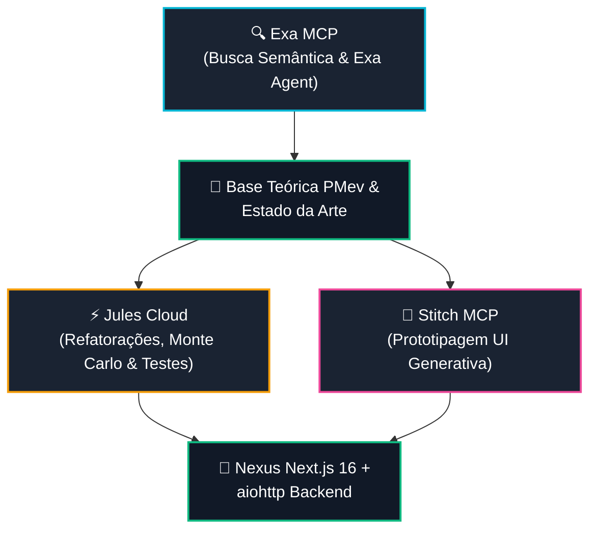

# SKILL: Exa MCP — Busca Semântica, Web Fetch & Exa Agent SOTA

> **Servidor MCP Remoto:** `https://mcp.exa.ai/mcp?tools=web_search_exa,web_fetch_exa,web_search_advanced_exa,agent_run` (JSON-RPC 2.0 / SSE)  
> **API REST Direta:** `https://api.exa.ai`  
> **Módulo Canônico:** [`engine/exa_bridge.py`](../../../engine/exa_bridge.py)  
> **Relatório Dinâmico:** [`EXA_REPORT.md`](../../../reports/integrations/EXA_REPORT.md)  
> **Sincronizador Oficial:** [`scripts/ops/sync_exa_report.py`](../../../scripts/ops/sync_exa_report.py)  
> **Membro da Tríade:** Stitch (UI), Jules (Cloud Dev/Refactor) e **Exa** (Busca Semântica & Pesquisa Autônoma)  
> **Equipe Vinculada:** `Raphael Vitoi's Personal` (`cmsxf2xch006ejw04uvohyrb8`) | **Rate Limit:** `10 QPS`  

---

## 1. Papel na Tríade SOTA & Governança de Credenciamento

O **Exa MCP** constitui o terceiro pilar da Tríade SOTA do ecossistema Nexus/Site:

* 🎨 **Google Stitch MCP:** Geração generativa de interfaces, prototipagem ágil e Design System `Obsidian Analytics`.
* ⚡ **Google Jules Cloud:** Despacho de tarefas assíncronas em VMs descartáveis de nuvem, refatorações em lote e testes de Monte Carlo.
* 🔍 **Exa MCP:** Radar epistêmico contínuo na web aberta, indexação neural semântica de artigos acadêmicos sobre Teoria dos Jogos/ICM/PMev, crawling limpo de páginas e execução autônoma de pesquisas multi-etapa via **Exa Agent**.

> [!IMPORTANT]
> **Piso de Segurança e Injeção Hermética:**
> A credencial de acesso (`EXA_API_KEY`) reside exclusivamente no ambiente do usuário (`HKCU:\Environment\EXA_API_KEY`) e nunca em texto claro versionado.
> O transporte MCP opera via HTTP SSE (`text/event-stream`), exigindo os cabeçalhos `Accept: application/json, text/event-stream` e `x-api-key: ${EXA_API_KEY}`.

---

## 2. Matriz das 4 Ferramentas Canônicas do Exa MCP

| Ferramenta MCP | Título Oficial | Função Operacional | Modo de Uso Recomendado |
| :--- | :--- | :--- | :--- |
| `web_search_exa` | **Web Search** | Busca semântica natural baseada no significado da página ideal, e não apenas em palavras-chave. Retorna texto limpo e destaques. | Ideal para queries conceituais, heurísticas de poker, perfis e descobertas rápidas. |
| `web_search_advanced_exa` | **Advanced Search** | Busca com controle granular sobre domínios (`includeDomains`/`excludeDomains`), categorias (`pdf`, `news`, `people`, `github`), datas e sumários. | Pesquisa de papers no arXiv, investigações técnicas e varredura temporal controlada. |
| `web_fetch_exa` | **Fetch Web Pages** | Extração de páginas completas em markdown limpo a partir de URLs fornecidas, eliminando boilerplate HTML/anúncios. | Alimentação de contexto RAG, síntese de documentações e leitura profunda de links. |
| `agent_run` | **Exa Agent** | Agente autônomo de pesquisa que itera em múltiplos passos de busca, refinamento, cruzamento de fontes e validação contra schema JSON. | Tarefas complexas de enriquecimento de dados, benchmarks concorrenciais e dossiês temáticos. |

---

## 3. Esteira de Pesquisa Contínua (Exa → Jules → Stitch → Nexus Site)



---

## 4. Playbook de Invocação Rápida via Python Bridge

```python
from engine.exa_bridge import ExaClient

client = ExaClient()

# 1. Busca semântica natural:
#    Descreva a página ideal ("artigo detalhando cálculo de ICM em torneios PKO")
response = client.search(
    query="Artigo detalhando calculo do Independent Chip Model ICM em torneios PKO",
    num_results=3,
    objective="Recuperar formulas matematicas e implicacoes estrategicas",
)
for item in response.results:
    print(f"[{item.score}] {item.title} -> {item.url}")

# 2. Busca avançada em papers acadêmicos e PDFs:
adv_response = client.search_advanced(
    query="Game Theory Equilibrium Multiway Push Fold Algorithms",
    category="pdf",
    include_domains=["arxiv.org"],
    num_results=5,
    enable_summary=True,
    enable_highlights=True,
)

# 3. Leitura e extração de conteúdo em markdown limpo:
pages = client.fetch(
    urls=["https://arxiv.org/abs/2105.00000"],
    max_characters=4000,
)

# 4. Disparo de pesquisa profunda via Exa Agent:
run = client.run_agent(
    query="Mapear a evolucao do conceito de Risk Premium no poker moderno entre 2020 e 2026",
    effort="low",
    max_cost_dollars=1.0,
)
print(f"Exa Agent Run ID: {run.run_id} | Status: {run.status}")

# 5. Sincronizar relatório dinâmico:
# python scripts/ops/sync_exa_report.py --write
```

---

## 5. Retorno de Investimento Diário (ROI Quantitativo & Qualitativo)

1. **Eficiência de Pesquisa:** Redução drástica do ruído de busca via web scraping manual; o Exa entrega texto já limpo, tipado e sem anúncios.
2. **Qualidade Epistêmica:** Busca orientada à semântica densa, conectando conceitos avançados de Teoria dos Jogos e PMev a fontes de alta autoridade.
3. **Harmonização da Tríade:** Alimentação direta de dados factualizados para os agentes de código (Jules) e design (Stitch), eliminando alucinações contextuais.
