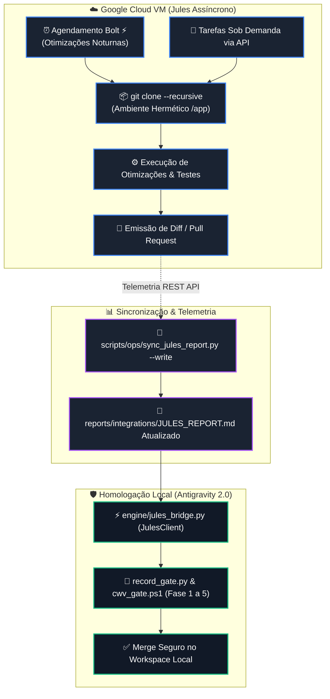

# SKILL: Google Jules Cloud — Orquestração Assíncrona & Engenharia em Nuvem

> **Plataforma Oficial:** [jules.google.com](https://jules.google.com/)  
> **API REST v1alpha:** `https://jules.googleapis.com/v1alpha`  
> **Módulo Canônico:** [`engine/jules_bridge.py`](../../../engine/jules_bridge.py)  
> **CLI Operacional:** [`scripts/ops/run_jules_agent.py`](../../../scripts/ops/run_jules_agent.py)  
> **Relatório Dinâmico:** [`JULES_REPORT.md`](../../../reports/integrations/JULES_REPORT.md)  
> **Sincronizador Oficial:** [`scripts/ops/sync_jules_report.py`](../../../scripts/ops/sync_jules_report.py)  
> **Governança:** Protocolo Master Chico SOTA v8.0 GOLD · Tríade Stitch, Exa & Jules · Régua `CLAUDE.md §10`  

---

## 1. Alinhamento de Produção & Seleção de Modelo

> **O MODELO NÃO É CONFIGURÁVEL POR REQUISIÇÃO, E ESTA SKILL NÃO O ROTEIA.**
>
> **Mesmo padrão do Stitch** (Tier 0, 2026-09-04): o seletor de modelo existe e é
> do operador, mas vive nas **preferências da interface**
> ([jules.google.com/settings/general](https://jules.google.com/settings/general)) —
> não no portão de entrada.
>
> Medido na API v1alpha e nas ferramentas MCP do Jules: a `createSession` aceita
> `prompt`, `title`, `sourceContext`, `requirePlanApproval` e `automationMode`. Nenhuma
> expõe seleção de modelo.
>
> Para trocar o modelo do Jules, use as preferências da própria plataforma (Gemini 3.8 Flash ou Gemini 3.1 Pro).

### Configuração da Conta & Cotas

- **Modelo Operacional Ativo:** `Gemini 3.8 Flash` (selecionado nas preferências para velocidade extrema, contexto ultra-amplo e raciocínio técnico sem latência).
- **Assinatura:** `Jules in Pro` (Workflows intensivos contínuos)
- **Cotas:** São próprias da conta e gerenciadas pela plataforma Jules.
- **Credenciais:** Chave `JULES_API_KEY` persistida em `HKCU:\Environment:JULES_API_KEY` (Pure ASCII, zero plaintext no Git).

---

## 2. Topologia Operacional: Nuvem, Sincronização e Homologação



---

## 3. Matriz de Endpoints REST da API Jules (v1alpha)

| Recurso / Ação | Método HTTP & Path | Descrição |
| :--- | :--- | :--- |
| **Listar Fontes** | `GET /v1alpha/sources` | Retorna repositórios GitHub conectados via GitHub App. |
| **Consultar Fonte** | `GET /v1alpha/{name=sources/**}` | Retorna detalhes da fonte, branches e default branch. |
| **Criar Sessão** | `POST /v1alpha/sessions` | Inicia sessão na VM com `sourceContext`, `startingBranch`, `requirePlanApproval` e `automationMode`. |
| **Listar Sessões** | `GET /v1alpha/sessions` | Lista sessões registradas com paginação (`pageSize`, `pageToken`). |
| **Consultar Sessão** | `GET /v1alpha/sessions/{id}` | Status consolidado, estados (`QUEUED`, `IN_PROGRESS`, `COMPLETED`, `FAILED`) e `outputs`. |
| **Aprovar Plano** | `POST /v1alpha/sessions/{id}:approvePlan` | Aprova o plano de execução gerado pelo agente na sessão. |
| **Enviar Mensagem** | `POST /v1alpha/sessions/{id}:sendMessage` | Envia instruções complementares para sessões em andamento. |
| **Listar Atividades** | `GET /v1alpha/sessions/{id}/activities` | Linha do tempo completa: comandos bash, patches de código e screenshots. |
| **Consultar Atividade** | `GET /v1alpha/sessions/{id}/activities/{aid}` | Detalhamento atômico de uma atividade. |
| **Obter Diff** | `GET /v1alpha/sessions/{id}/diff` | Retorna patch unidiff consolidado e arquivos alterados. |

---

## 4. Playbook Operacional via CLI Oficial (`scripts/ops/run_jules_agent.py`)

```bash
# 1. Listar fontes conectadas:
python scripts/ops/run_jules_agent.py sources

# 2. Criar nova sessão assíncrona com Pull Request automático:
python scripts/ops/run_jules_agent.py create "Otimizar lookup de matrizes de poker em frontend/src/lib/poker/" \
  --title "Bolt: Otimizacao de Matrizes" \
  --auto-approve \
  --auto-pr \
  --sync

# 3. Listar sessões existentes em formato JSON:
python scripts/ops/run_jules_agent.py list --page-size 10 --json

# 4. Consultar status e progresso de uma sessão:
python scripts/ops/run_jules_agent.py get 13016237541351365147

# 5. Coletar o diff unidiff e lista de arquivos alterados:
python scripts/ops/run_jules_agent.py diff 13016237541351365147

# 6. Aprovar plano explicitamente:
python scripts/ops/run_jules_agent.py approve 13016237541351365147

# 7. Enviar mensagem de refinamento:
python scripts/ops/run_jules_agent.py send 13016237541351365147 "Garanta que os tipos TypeScript continuem sem 'any'"
```

---

## 5. Playbook de Invocação Rápida via Python Bridge

```python
from engine.jules_bridge import JulesClient, JulesSessionRequest

client = JulesClient()

# 1. Disparar otimização rápida de performance com automação de PR:
status = client.create_session(
    JulesSessionRequest(
        source="sources/github/RaphaelVitoi/Site",
        prompt="Bolt ⚡: Identificar e otimizar funcoes de ordenacao no frontend/src/lib/telemetry-client.ts",
        branch="master",
        auto_approve_plan=True,
        title="Bolt: Telemetry Client Optimization",
        automation_mode="AUTO_CREATE_PR",
    )
)
print(f"Sessao criada: {status.session_id} | Status: {status.state} | PR: {status.pr_url}")

# 2. Consultar status da sessão:
current_status = client.get_session_status(status.session_id)
print(f"Status atual: {current_status.state}")

# 3. Baixar e inspecionar o patch/diff gerado:
if current_status.state == "COMPLETED":
    diff = client.get_diff(status.session_id)
    print(f"Arquivos alterados: {diff.files_changed}")
    print(diff.diff_content)
```

---

## 6. Governança & Régua Jules (`CLAUDE.md §10`)

1. **Meça antes de otimizar:** Meça baseline com telemetria antes de gerar diffs; melhorias inferiores a 5% devem ser refutadas e arquivadas.
2. **Ordene em vez de perguntar:** Formulação clara e determinística no prompt inicial.
3. **Não aplique `React.memo` por varredura:** Preservar estabilidade de referências de hooks e contratos de componentes.
4. **Nunca crie `.jules/` no repositório:** A memória de performance reside exclusivamente em `.claude/agent-memory/bolt/MEMORY.md`.
5. **Isolamento e Homologação:** Nenhuma branch ou PR gerado pelo Jules é mesclado em `master` sem aprovação em 5/5 fases do `cwv_gate.ps1`.
