# SKILL: Google Cloud Stitch — UI Generativa & Design Systems SOTA

> **Plataforma Web Oficial:** [stitch.withgoogle.com](https://stitch.withgoogle.com/)  
> **Servidor MCP Remoto:** `https://stitch.googleapis.com/mcp` (JSON-RPC 2.0)  
> **Módulo Canônico:** [`engine/stitch_bridge.py`](../../../engine/stitch_bridge.py)  
> **Relatório Dinâmico:** [`STITCH_REPORT.md`](../../../reports/integrations/STITCH_REPORT.md)  
> **Sincronizador Oficial:** [`scripts/ops/sync_stitch_report.py`](../../../scripts/ops/sync_stitch_report.py)  
> **Projeto Vinculado:** `projects/18242753218562483944` (*Nexus PMev & Poker Racional UI*)  
> **Design System Ativo:** `Obsidian Analytics` (`assets/6f9c8c6e7114422393d45b0c4ca02808`)  

---

## 1. Motor Generativo & Tiers de Modelo (Gemini 3.8 Flash & 3.5 Flash-Lite)

O Google Cloud Stitch opera em ambiente de produção com dois tiers principais de inteligência multimodal:

* ✨ **Balanced (Padrão — `GEMINI_3_8_FLASH`):** Máxima fidelidade aos tokens do Design System, aderência refinada a glassmorphism e hierarquia tipográfica complexa. Ideal para novas telas executivas e painéis analíticos.
* ⚡ **Speed (`GEMINI_3_5_FLASH_LITE`):** Latência ultra-baixa, ideal para iterações rápidas, geração múltipla de variantes e prototipagem exploratória.
* 🌐 **Seleção Omnicanal:**
  - **Na Interface Web:** O seletor no topo da tela do Stitch permite alternar entre `Balanced` e `Speed`.
  - **No Bridge Python (`stitch_bridge.py`):** O parâmetro `model_tier` aceita os rótulos amigáveis (`"BALANCED"`, `"SPEED"`) ou os enums canônicos da API (`"GEMINI_3_8_FLASH"`, `"GEMINI_3_5_FLASH_LITE"`). Se omitido, o gateway adota o padrão do servidor.

---

## 2. Design System Canônico: `Obsidian Analytics`

O Stitch sintetiza as diretrizes estéticas do Poker Racional a partir de [frontend/src/app/globals.css](../../../frontend/src/app/globals.css):

* **Fundo & Superfícies:** `Canvas Deep` (`#030610`), `Space Base` (`#0F1729`), `Panel Surface` (`#344154` com backdrop blur de 20px).
* **Bordas & Brilhos:** Contornos perimetrais de 1px com brilho dourado (`rgba(242, 183, 43, 0.15)`).
* **Paleta Semântica PMev:**
  - 🟡 **Gold (`#f2b72b`):** Ações primárias, marcas SOTA e métricas de alta relevância.
  - 🟢 **Emerald (`#54dea2`):** Regiões de lucro, valor esperado positivo (+EV) e zonas seguras.
  - 🔴 **Rose (`#EE445E`):** Zonas de risco estocástico, vazamentos (*leaks*) e insolvência.
  - 🟣 **Math Indigo (`#6467F2`):** Operadores lógicos, equações KaTeX e equilíbrios de Nash.
* **Tipografia Dupla:** `Geist` para interfaces executivas e `JetBrains Mono` para dados tabulares, EV e stack sizes.

---

## 3. Matriz de Ferramentas Stitch MCP (16 Ferramentas Canônicas)

| Categoria | Ferramenta MCP | Função Operacional |
| :--- | :--- | :--- |
| **Geração & Prototipagem** | `generate_screen_from_text` | Cria tela do zero com prompt e design system opcional. |
| **Edição & Refinamento** | `edit_screens` | Aplica ajustes pontuais a telas existentes via prompt. |
| **Variantes de Design** | `generate_variants` | Produz 1 a 5 variações focando em layout, cores ou tipografia. |
| **Download de Ativos** | `download_file` | Baixa código HTML completo ou screenshot renderizado. |
| **Inspeção de Telas** | `list_screens`, `get_screen` | Inventaria e detalha telas criadas em um projeto. |
| **Sistemas de Design** | `upload_design_md` | Envia documento estruturado `DESIGN.md` em base64. |
| **Sistemas de Design** | `create_design_system_from_design_md` | Converte `DESIGN.md` em Design System formal no Stitch. |
| **Sistemas de Design** | `list_design_systems`, `apply_design_system` | Lista e aplica tokens a instâncias de tela. |
| **Governança de Projetos** | `list_projects`, `get_project`, `create_project`, `delete_project` | Gerenciamento de ciclo de vida de projetos. |

---

## 4. Esteira de Prototipagem Não-Concorrente (Stitch → Next.js)

```mermaid
flowchart LR
    subgraph Conceito["💡 1. Formulação"]
        Req["Demanda de UI\n(Ex: Scanner Gravitacional)"]
    end

    subgraph StitchCloud["🎨 2. Stitch MCP Cloud"]
        Gen["generate_screen_from_text\n(Gemini 3.8 Flash / 3.5 Flash-Lite)"]
        Var["generate_variants\n(3 a 5 variações)"]
        DS["apply_design_system\n(Obsidian Analytics)"]
        Gen --> Var --> DS
    end

    subgraph Componentizacao["⚡ 3. Código Next.js"]
        HTML["download_file / get_screen\n(Extração de HTML/CSS)"]
        React["Componentes React 19 / Tailwind 4\n(frontend/src/components/)"]
        HTML --> React
    end

    subgraph Homologacao["🛡️ 4. Validação SOTA"]
        Gate["cwv_gate.ps1 (Fase 1 e 2)\nLighthouse + Core Web Vitals"]
    end

    Req --> Gen
    DS --> HTML
    React --> Gate

    classDef cloud fill:#1a2332,stroke:#ec4899,stroke-width:2px,color:#fff;
    classDef react fill:#111927,stroke:#3b82f6,stroke-width:2px,color:#fff;
    classDef gate fill:#111927,stroke:#10b981,stroke-width:2px,color:#fff;
    class Gen,Var,DS cloud;
    class HTML,React react;
    class Gate gate;
```



---

## 5. Playbook de Invocação Rápida via Python Bridge

```python
from engine.stitch_bridge import StitchClient

client = StitchClient()

# 1. Gerar nova tela com modelo Balanced (Gemini 3.8 Flash) e Obsidian Analytics:
screen = client.generate_screen_from_text(
    project_id="18242753218562483944",
    prompt="Painel de Comparacao de Nash com radar poligonal glassmorphism e realce dourado",
    model_tier="BALANCED",
    device_type="DESKTOP",
    design_system="assets/6f9c8c6e7114422393d45b0c4ca02808",
)

# 2. Gerar variantes exploratórias com modelo Speed (Gemini 3.5 Flash-Lite):
variants = client.generate_variants(
    project_id="18242753218562483944",
    screen_ids=["3260535219730569926"],
    prompt="Explorar variantes com maior densidade informacional e acento verde esmeralda",
    variant_count=3,
    creative_range="EXPLORE",
    model_tier="SPEED",
)

# 3. Listar todas as telas do projeto com acesso strongly typed ou dict:
screens = client.list_screens("18242753218562483944")
for sc in screens:
    print(f"Tela ID: {sc.id} | Titulo: {sc.title} | Dispositivo: {sc.device_type}")

# 4. Sincronizar relatorio geral:
# python scripts/ops/sync_stitch_report.py --write
```

---

## 6. Retorno de Investimento Diário (ROI Quantitativo & Qualitativo)

1. **Ideação visual acelerada:** A geração e síntese de variantes elimina horas de wireframing manual com total aderência ao dark glassmorphism.
2. **Consistência de tokens:** O vínculo com `Obsidian Analytics` garante conformidade estrita com cores, fontes `Geist`/`JetBrains Mono` e bordas iluminadas.
3. **Ponte fluida para produção:** Extração rápida de CSS/HTML via `download_file` e conversão direta para componentes Next.js 16 com Tailwind CSS 4.
