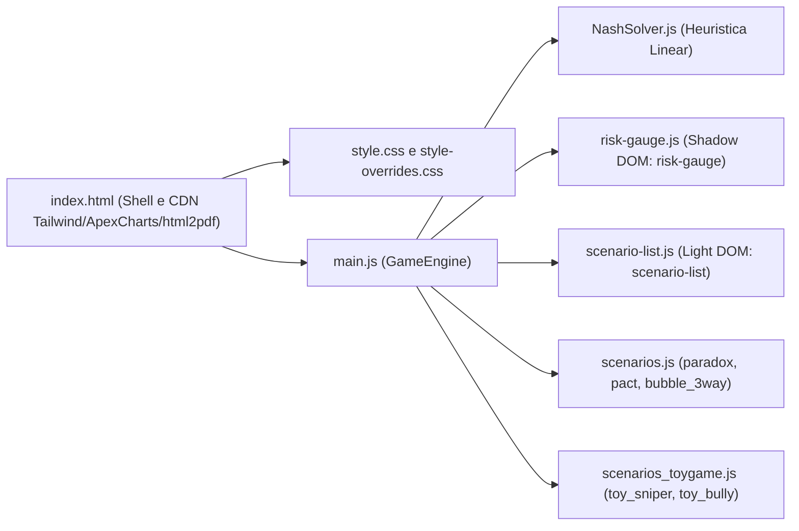

# SPEC: Epico aula-icm-rp - Aula de ICM, Risk Premium e Simulador Interativo

> **Soberania:** Raphael Vitoi (Tier 0) | **Escopo:** `docs/epics/aula-icm-rp/`
> **Fontes primarias:**
> [ENTENDENDO_ICM_HEURISTICAS_LEDGER.md](../../research/pmev/ENTENDENDO_ICM_HEURISTICAS_LEDGER.md),
> [AULA_1_2_EVIDENCE_LEDGER.md](../../research/pmev/AULA_1_2_EVIDENCE_LEDGER.md)
> e [SPEC_icm_toy.md](../../../frontend/src/content/interativo/SPEC_icm_toy.md)

---

## 1. Visao Geral e Linhagem Canonica

Este documento estabelece a especificacao tecnica, didatica e arquitetural do
epico `aula-icm-rp`, unificando tres frentes que evoluiram no diretorio:

1. **Aula Didatica (estado ativo):** [aula-icm-rp.md](aula-icm-rp.md), documento
   estruturado em 5 modulos cobrindo ICM pos-flop, os 8 Toy-Games de Risk
   Premium (RP) e extensoes da Perspectiva Matematica (PMev).
2. **Prototipo Interativo em Web Components ("Geometria do Risco | Architecture
   v2"):** [index.html](index.html), [main.js](main.js),
   [NashSolver.js](NashSolver.js), [risk-gauge.js](risk-gauge.js),
   [scenario-list.js](scenario-list.js), [scenarios.js](scenarios.js),
   [scenarios_toygame.js](scenarios_toygame.js), [style.css](style.css) e
   [style-overrides.css](style-overrides.css).
3. **Historico de Planejamento e Validacao:** artefatos preservados em
   [archived/](archived/) (`PRD.md`, `SPEC.md`, `PRD_M6_Interativo.md`,
   `SPEC_M6_Interativo.md`, `pesquisa.md`, `prompt.md`, `auditoria.md` e
   `RELATORIO_VALIDACAO.md`).

### 1.1 Saneamento Documental Executado (2026-11-15)

Anteriormente, este caminho (`docs/epics/aula-icm-rp/SPEC.md`) e o arquivo irmao
`IDENTITY_SPEC.md` abrigavam por erro de consolidacao a especificacao da Smart
CLI v2.0 ("A Membrana Inteligente", referente a `do.ps1`). Em 2026-11-15, esses
artefatos foram migrados para seu epico canonico em
[../cli-interativa/SPEC.md](../cli-interativa/SPEC.md) e
[../cli-interativa/IDENTITY_SPEC.md](../cli-interativa/IDENTITY_SPEC.md),
restaurando este arquivo como a especificacao unica e ativa de `aula-icm-rp`.

---

## 2. Fronteira Arquitetural e Epistemica

Em alinhamento com
[SPEC_icm_toy.md](../../../frontend/src/content/interativo/SPEC_icm_toy.md) e
[PERSPECTIVA_MATEMATICA_PMEV_MASTER.md](../../PERSPECTIVA_MATEMATICA_PMEV_MASTER.md),
toda implementacao ou revisao derivada deste epico deve preservar a separacao
estrita entre calculo deterministico, heuristica de modelo e saida de solver
externo:

| Camada                  | Pode produzir                                                  | Nao pode alegar                                             |
| :---------------------- | :------------------------------------------------------------- | :---------------------------------------------------------- |
| **ICM / BF / RP**       | Calculo condicionado a stacks e estrutura de payouts           | Estrategia GTO de solver sem ranges e arvore declarados     |
| **PMev / FGS / RIO**    | Saida do modelo teorico com parametros explicitos              | Validacao empirica independente de campo ou de solver       |
| **Toy-Games Didaticos** | Isolamento pedagogico de uma variavel (RP do IP vs. RP do OOP) | Substituicao integral de arvores multi-street reais         |
| **UI / Prototipo Web**  | Visualizacao de metricas, proveniencia e simulacao de margem   | Inferencia silenciosa de stacks, payouts ou ranges omitidos |

### 2.1 Limite de Verificacao dos Dados Numericos

Conforme registrado em [RELATORIO_VALIDACAO.md](archived/RELATORIO_VALIDACAO.md)
e
[ENTENDENDO_ICM_HEURISTICAS_LEDGER.md](../../research/pmev/ENTENDENDO_ICM_HEURISTICAS_LEDGER.md):

- Os **principios qualitativos e direcionais** dos 8 Toy-Games (`Teto do RP`,
  `Pacto Silencioso`, `RP de ida vs. RP de volta`, `Vantagem de Risco`,
  `Mesa como Organismo` e a assimetria contra-intuitiva da Parte II) estao
  confirmados diretamente pelo ledger da fonte primaria
  (`Entendendo o ICM e suas heuristicas.docx`).
- Os **valores numericos pontuais** de combos de bluff (`3`, `4,2`, `5`, `8`), a
  estimativa de aproximadamente `80%` de fold no Toy-Game 8 e os percentuais
  ilustrativos do exemplo de _Downward Drift_ no spot `A8s3r` (`fold 35%`,
  `check-raise 10%` vs. `12%`) sao tratados como **ancoras didaticas**, nao como
  transcricoes auditadas no nivel de no de solver, enquanto nao houver export
  verificado por captura (padrao adotado em
  [AULA_1_2_EVIDENCE_LEDGER.md](../../research/pmev/AULA_1_2_EVIDENCE_LEDGER.md)).

---

## 3. Especificacao da Aula Didatica (`aula-icm-rp.md`)

### 3.1 Requisitos Editoriais e Pedagogicos

- **Publico-alvo:** jogadores profissionais intermediarios de MTT (AVG buy-in de
  US\$ 109 a US\$ 530), ja proficientes em ChipEV, pot odds, equidade e uso
  basico de solvers.
- **Idioma e estilo:** portugues (`pt-BR`), voz direta e densa de Raphael Vitoi,
  sem introducoes basicas de poker e sem validacao emocional vazia.
- **Restricao tipografica (NF-06):** o texto da aula nao deve empregar travessao
  duplo (`--`) como pontuacao; utilizar virgula, ponto, ponto e virgula ou
  parenteses conforme o caso.
- **Nomenclatura original preservada:** `Teto do RP`,
  `RP de ida vs. RP de volta`, `Pacto Silencioso`, `Vantagem de Risco`,
  `Desvantagem de Risco`, `Mesa como Organismo` e `Antevisao` (sem renomear ou
  diluir). O termo `Batata Quente` permanece identificado como conceito didatico
  derivado da especificacao para o fenomeno do Toy-Game 2.

### 3.2 Mapa Estrutural dos 5 Modulos

| Modulo                                         | Secoes em `aula-icm-rp.md` | Nucleo Conceitual e Metricas                                                                                                                                                                                                                                                                                                                                                                                  |
| :--------------------------------------------- | :------------------------- | :------------------------------------------------------------------------------------------------------------------------------------------------------------------------------------------------------------------------------------------------------------------------------------------------------------------------------------------------------------------------------------------------------------ |
| **Modulo 1: O Problema e o Mapa**              | 1.1 a 1.4                  | ICM desde a mao 1 (~1,8% de RP medio em MTT de 200 jogadores); custo de jogar ChipEV em bolha/FT (>10% do buy-in, >30% em 3-bet pots); formulas de RP e Bubble Factor $BF = 100 / (100 - RP)$; Lei da utilidade decrescente das fichas e responsabilidade de pressao do Chip Leader.                                                                                                                          |
| **Modulo 2: Toy-Games como Laboratorio**       | 2.1 a 2.4                  | Setup controlado em `22223` (`AA, QQ, JJ` vs. `KK`); Parte I (TG1-TG5, RP crescente no OOP); Parte II (TG6-TG8, RP invertido); tabela consolidada de conceitos emergentes.                                                                                                                                                                                                                                    |
| **Modulo 3: ICM Pos-Flop, a Fronteira**        | 3.1 a 3.9                  | `Downward Drift` (reducao baseline de `12%` a `15%` nos sizings e exemplo `A8s3r` BTN 40bb vs. BB 70bb); `SPR` e diluicao de RP por street; `Compounding` de cobertura; Check-back com premiums (`AA`); `Bunching Effect` (HRC global vs. GTO Wizard HU efetivo); `RIO` como passivo estrutural e colapso multiway; `Prova dos 41%` ($\approx 28\%$ RP max, $BF \approx 1,388$); guia pratico de estudo solo. |
| **Modulo 4: Variaveis Contextuais**            | 4.1 a 4.6                  | Payouts `Flat` vs. `Top-Heavy` (variacao de ate `5,7%` no RP medio); `FGS` vs. ICM classico; `Erosao Antecipada (t-3)` e urgencia posicional; `Fator Psi` (ruido humano e node-locking); `Lei da Gravidade Estrategica` (modelo orbital); `PKO` e Vetor de Reembolso.                                                                                                                                         |
| **Modulo 5: Aplicacao Pratica e Erros Comuns** | 5.1 a 5.3                  | Os 10 erros mais comuns com correcao acionavel; Protocolo de 10 segundos (6 passos antes de agir); Conexoes interdisciplinares (Teoria do Prospecto de Kahneman & Tversky 1979, Teoria de Sistemas, Equilibrio de Nash sob utilidade concava).                                                                                                                                                                |

### 3.3 Especificacao dos 8 Toy-Games (Modulo 2)

Parametros invariantes do laboratorio:

- **Board:** $2\spadesuit 2\heartsuit 2\diamondsuit 2\clubsuit 3\spadesuit$
  (`22223`, textura estatica sem draws).
- **Range IP:** `AA`, `QQ`, `JJ` (18 combinacoes totais; no setup reduzido do
  Toy-Game 1, 6 combos de valor contra combos variaveis de bluff).
- **Range OOP:** `KK` (6 combinacoes totais, bluffcatcher puro).
- **Pote e Aposta:** pote de `100` fichas; unica acao agressiva permitida de
  `100` fichas (all-in, pot-size bet). OOP sempre da check primeiro.

| Cenario        | RP IP (%) | RP OOP (%) | Comportamento IP (Agressor)         | Comportamento OOP (Defensor)      | Conceito Principal                             |
| :------------- | --------: | ---------: | :---------------------------------- | :-------------------------------- | :--------------------------------------------- |
| **Toy-Game 1** |         0 |          0 | 3 combos de bluff (`a = 33,3%`)     | Paga `50%` via MDF classico       | Baseline ChipEV e indiferenca de Nash          |
| **Toy-Game 2** |         3 |          6 | Aumenta bluffs para 4,2 combos      | Folda ligeiramente acima de `50%` | Risco unidirecional (sem re-shove em `<25bb`)  |
| **Toy-Game 3** |         3 |          9 | Aumenta bluffs para 5 combos        | Estabiliza a defesa no piso       | **Teto do RP** (limite anti-exploracao)        |
| **Toy-Game 4** |         3 |         18 | Desbalanceia para 8 combos de bluff | Mantem defesa no Teto do RP       | Equilibrio ICM concavo tolera overbluff        |
| **Toy-Game 5** |         3 |         24 | Pressao maxima sobre o Teto         | Invariancia de defesa no limite   | Respostas de equilibrio raramente sao binarias |
| **Toy-Game 6** |         9 |          3 | Blefa ligeiramente acima do ChipEV  | Paga **menos** que no baseline    | Inversao contra-intuitiva de defesa            |
| **Toy-Game 7** |        18 |          3 | Mantem range inclinado a bluffs     | Intensifica o overfold            | Utilidade marginal decrescente do CL           |
| **Toy-Game 8** |        21 |          3 | Mesmo range de shove inclinado      | Atinge ~`80%` de fold             | **Mesa como Organismo** e payjump passivo      |

---

## 4. Arquitetura do Simulador Interativo ("Geometria do Risco")

O diretorio `docs/epics/aula-icm-rp/` abriga um prototipo autonomo em HTML, CSS
e ES Modules nativos (Web Components) que precede e alimenta o motor de producao
em TypeScript.

### 4.1 Contrato do Motor Prototipo (`NashSolver.js`) vs. Producao (`nashSolver.ts`)

O prototipo local [NashSolver.js](NashSolver.js) implementa uma aproximacao
didatica linear para pot-size bet
(`BASELINE: ALPHA = 33.33, MDF = 50, EQUITY = 33.33`):

1. **Sanitizacao:** `safeIpRp >= 0`, `safeOopRp >= 0`, `safeFactor` limitado ao
   intervalo `[0.1, 3]`.
2. **Defesa ajustada (`defense`):** $50 - 1,4 \cdot \text{RP}_{\text{OOP}} + 0,2
   \cdot \text{RP}_{\text{IP}}$, limitada em `[0, 100]`.
3. **Frequencia de bluff (`bluff`):** $(33,33 + \text{RP}_{\text{OOP}} - 1,1
   \cdot \text{RP}_{\text{IP}}) \cdot \text{safeFactor}$, limitada em
   `[0, 100]`.
4. **Equidade requerida (`evDiff`):** $\text{requiredEquity} = 33,33 +
   \text{RP}_{\text{OOP}}$.
5. **Simulacao por mao (`simulateHand`):** compara
   `handEquity - requiredEquity`, retornando `CALL` ou `FOLD`, margem e flag
   `isClose` (`|diff| < 2`).

**Delta arquitetural para o motor de producao:** o ecossistema ativo em Next.js
([nashSolver.ts](../../../frontend/src/components/simulator/solver/nashSolver.ts),
funcao `solveIcmDistortion`) substituiu o modelo linear por uma formulacao
nao-linear com gravidade do pote (`gravity`, `damping`), expoente de concavidade
(`bExponent`), suporte a RP negativo no river (`[-100, 100]`), teto de defesa
dinamico (`maxFoldAllowed`) e penalizacao multiway (`activePlayers`).
Paralelamente, o simulador HTML standalone M6 foi materializado em
[icm_toy_game_simulator.html](../../../frontend/src/content/interativo/icm_toy_game_simulator.html)
sob o contrato
[SPEC_icm_toy.md](../../../frontend/src/content/interativo/SPEC_icm_toy.md).

### 4.2 Interface e Web Components

- **`<risk-gauge>` ([risk-gauge.js](risk-gauge.js)):** Shadow DOM isolado
  observando `value`, `label`, `pos`, `stack`, `color`, `threshold`,
  `opponent-value` e `muted`. Dispara estado `death` quando o proprio RP atinge
  `threshold` (padrao `20` em `main.js`), estado `predator` quando o oponente
  entra em zona critica, e log de easter egg no console quando `RP > 40%`.
- **`<scenario-list>` ([scenario-list.js](scenario-list.js)):** Light DOM que
  renderiza botoes a partir de `data` (`ALL_SCENARIOS`) e emite evento `select`
  com o `id` do cenario.
- **Modulos de cenario:**
  - [scenarios.js](scenarios.js): `paradox` (BTN 40bb RP `21.4` vs. BB 55bb RP
    `12.9`), `pact` (CO 65bb RP `24.5` vs. BTN 70bb RP `23.5`) e `bubble_3way`
    (BTN 85bb RP `10.5` vs. BB 12bb RP `42`).
  - [scenarios_toygame.js](scenarios_toygame.js): `toy_sniper` (SB 50bb RP `12`
    vs. BB 12bb RP `45`) e `toy_bully` (BTN 80bb RP `5` vs. SB 20bb RP `42`).

### 4.3 Estado Estrutural do Prototipo Colocado (Atualizado em 2026-11-15)

Os desvios de importacao e DOM originalmente encontrados em
`docs/epics/aula-icm-rp/` foram saneados:

1. **Folha de estilo e imports corrigidos:** [index.html](index.html) carrega
   `./style.css`, `./style-overrides.css` e `./main.js` em caminhos locais
   validos, e [main.js](main.js) importa `TOY_GAMES` de
   `./scenarios_toygame.js`.
2. **Modo de comparacao restaurado no DOM:** `#btn-mode-compare`,
   `#single-scenario-view` e `#compare-area` existem em
   [index.html](index.html), com `aria-pressed` sincronizado e destruicao limpa
   da instancia `ApexCharts` entre trocas.
3. **Atualizacao cirurgica sem perda de foco:** `recalcScenario()` atualiza
   `#stats-metrics-container`, `#main-chart` e `#sim-result` preservando a barra
   de controles (`#agression-slider`) e os inputs da simulacao reversa durante o
   arraste.
4. **Higiene Web Components e movimento reduzido:**
   [scenario-list.js](scenario-list.js) aplica `escapeHTML`, `type="button"` e
   `aria-pressed`; [risk-gauge.js](risk-gauge.js) e [style.css](style.css)
   condicionam animacoes continuas a
   `@media (prefers-reduced-motion: no-preference)`.
5. **Desalinhamento remanescente de catalogo:** os 5 cenarios em
   [scenarios.js](scenarios.js) e [scenarios_toygame.js](scenarios_toygame.js)
   modelam situacoes pre-flop e de bolha (`paradox`, `pact`, `bubble_3way`,
   `toy_sniper`, `toy_bully`), enquanto os 8 Toy-Games do board `22223` (Modulo
   2 de `aula-icm-rp.md`) seguem na linha `icm_toy_game_simulator.html` /
   `MasterSimulator`.

---

## 5. Seguranca, Higienizacao e Acessibilidade

- **Prevencao de XSS:** `main.js` aplica `escapeHTML()` sobre strings
  interpoladas em mensagens de erro, titulos, contextos e relatorio PDF
  (`html2pdf`).
- **Controle de audio e autoplay:** `GameEngine` inicia com
  `this.isMuted = true`, propagando o atributo `muted` para `<risk-gauge>` ate
  acao explicita do usuario em `#btn-toggle-mute`.
- **Acessibilidade de movimento:** [style.css](style.css) e
  [style-overrides.css](style-overrides.css) implementam
  `@media (prefers-reduced-motion: reduce)` sem `!important`, desativando
  animacoes de ticker e transicoes de botoes.
- **Integridade de metricas:** nenhuma interface pode apresentar `Delta RP` como
  multiplicador universal de frequencia, rotular aproximacoes lineares de
  `NashSolver.js` como equilibrio GTO exato ou ocultar parametros declarados de
  cenario.

---

## 6. Criterios de Aceite e Verificacao

### 6.1 Portoes de Qualidade Documental

- [x] Frontmatter YAML canonico (`title`, `type`, `status`, `owner`,
      `updated_at`).
- [x] H1 unico com hierarquia de headings contigua (sem saltos de nivel).
- [x] Zero links com esquema local `file:` e zero marcadores literais de
      pendencia aberta em texto canonico.
- [x] Zero travessoes duplos (`--`) em conformidade com NF-06 do epico.
- [x] Aprovacao com zero erros no linter `markdownlint-cli2` com a configuracao
      da raiz do repositorio.

### 6.2 Criterios de Aceite de Dominio e Evolucao

1. **Coerencia didatica:** os 5 modulos de [aula-icm-rp.md](aula-icm-rp.md)
   permanecem alinhados a nomenclatura original de Raphael Vitoi e aos ledgers
   de evidencia em `docs/research/pmev/`.
2. **Transparencia epistemica:** qualquer promocao dos valores indicativos dos
   Toy-Games (TG1-TG8) ou do exemplo `A8s3r` para valores prescritivos exige
   ledger verificavel no padrao de
   [AULA_1_2_EVIDENCE_LEDGER.md](../../research/pmev/AULA_1_2_EVIDENCE_LEDGER.md).
3. **Evolucao do prototipo colocado:** caso [index.html](index.html) seja
   promovido de prototipo didatico a entrega de usuario final, adicionar os 8
   Toy-Games de `22223` ao catalogo ou migrar a visualizacao para
   `solveIcmDistortion` em
   [nashSolver.ts](../../../frontend/src/components/simulator/solver/nashSolver.ts),
   preservando o aviso didatico da UI.
