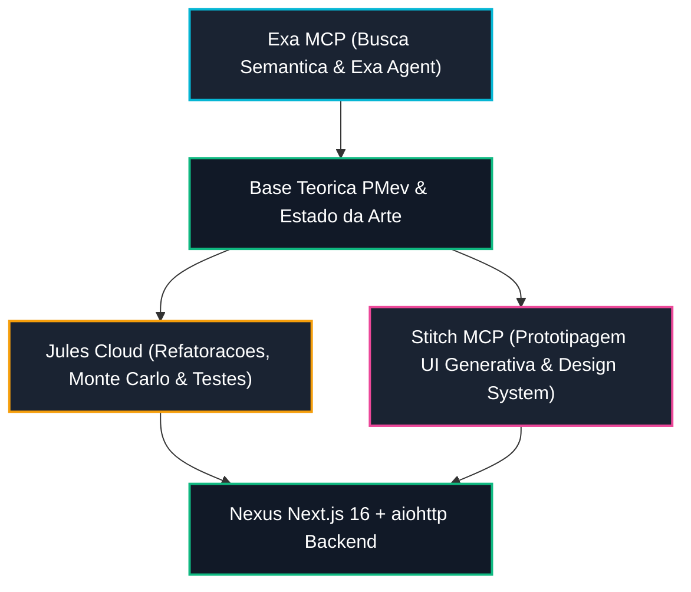

# Exa MCP - Relatorio de Governanca, Busca Semantica & Pesquisa Autonoma

> **Repositorio Monitorado:** `RaphaelVitoi/Site`
> **Governanca:** Protocolo Master Chico SOTA v8.0 GOLD . Triade Stitch, Exa & Jules
> **Data de Atualizacao:** `2026-11-08 10:35:07 UTC`
> **Origem dos Dados:** Exa Hosted MCP (`https://mcp.exa.ai/mcp`) & Exa API (`https://api.exa.ai`)

---

## 1. Resumo Executivo da Conexao Exa MCP

| Dimensao | Valor | Status Operacional |
| :--- | :--- | :--- |
| **Status de Conexao** | `CONECTADO E OPERACIONAL` | [OK] Operacional |
| **Equipe / Team** | `Raphael Vitoi's Personal` (`cmsxf2xch006ejw04uvohyrb8`) | Workspace Pessoal Autenticado |
| **Taxa Limite (Rate Limit)** | `10 QPS` | Capacidade nominal para buscas concorrentes |
| **Chave Ativa em Producao** | `exa1` | Configurada em `HKCU:\Environment\EXA_API_KEY` |
| **Latencia de Probe Medida** | `1985.74 ms` | Ingestao e ranking semantico em tempo real |
| **Transporte MCP** | HTTP SSE (`text/event-stream` / JSON-RPC 2.0) | Header `Accept: application/json, text/event-stream` |

---

## 2. Catalogo das 4 Ferramentas Exa MCP

| Ferramenta MCP | Titulo Oficial | Funcao Operacional | Disponibilidade |
| :--- | :--- | :--- | :--- |
| `web_search_exa` | **Web Search** | Busca semantica em linguagem natural na web com retorno de conteudo limpo. | `HABILITADO` |
| `web_search_advanced_exa` | **Advanced Web Search** | Busca avancada com filtros por dominio, categorias (people, news, pdf), datas e sumarios. | `HABILITADO (opt-in via tools parameter)` |
| `web_fetch_exa` | **Fetch Web Pages** | Extracao de texto completo em markdown purificado a partir de URLs conhecidas. | `HABILITADO` |
| `agent_run` | **Exa Agent** | Pesquisa profunda autonoma em multiplas etapas com suporte a budget, esforco e output schema. | `HABILITADO (via API Key / OAuth)` |

---

## 3. Validacao Empirica & Telemetria de Probe

- **Consulta de Teste Executada:** `Raphael Vitoi Poker Racional PMev`
- **Tempo de Resposta:** `1985.74 ms`
- **Resultados Retornados:** `2`

### Resultado #1: CNC Poker
- **URL:** [https://cncpoker.com/coaches/rapha-vitoi](https://cncpoker.com/coaches/rapha-vitoi)
- **Data de Publicacao:** `N/A`
- **Previa Textual:** *Title: CNC Poker URL: https://cncpoker.com/coaches/rapha-vitoi Published: N/A Author: N/A Highlights: CNC Poker  #### Coach Profile  #### Raphael Tavares Medeiros  ##### @Rapha Vitoi  Premium  ### LIV*

### Resultado #2: RPTeam
- **URL:** [https://www.rafapokerteam.com.br/](https://www.rafapokerteam.com.br/)
- **Data de Publicacao:** `N/A`
- **Previa Textual:** *Title: RPTeam URL: https://www.rafapokerteam.com.br/ Published: N/A Author: N/A Highlights: RPTeam  # Nós somos RAFA POKER TEAM.    Selecionamos, treinamos e desenvolvemos jogadores em todos os limite*

---

## 4. Esteira de Pesquisa Continua na Triade (Jules . Stitch . Exa)



### Playbook de Invocacao Rapida via Python Bridge

```python
from engine.exa_bridge import ExaClient

client = ExaClient()

# 1. Busca semantica natural:
resp = client.search(query="ICM multiway push fold equilibrium math", num_results=5)
for r in resp.results:
    print(f"{r.title} -> {r.url}")

# 2. Busca avancada com filtros:
adv_resp = client.search_advanced(
    query="Game Theory Poker Mathematical Foundations",
    category="pdf",
    include_domains=["arxiv.org"],
    enable_summary=True,
)

# 3. Disparo de pesquisa profunda via Exa Agent:
agent_run = client.run_agent(
    query="Mapear os 5 principais artigos recentes sobre Independent Chip Model em torneios PKO",
    effort="low",
    max_cost_dollars=1.0,
)
print(f"Run ID: {agent_run.run_id} | Status: {agent_run.status}")
```

---
*Relatorio emitido pelo Sincronizador Exa MCP - Protocolo Chico SOTA v8.0 GOLD*
